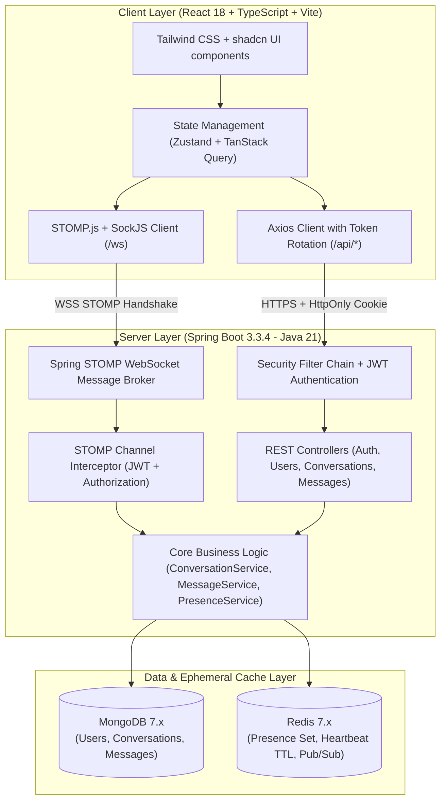

# Real-Time Enterprise Chat Application

A high-performance, real-time messaging application built with **Spring Boot 3 (Java 21)**, **React 18 (TypeScript + Vite)**, **WebSocket (STOMP + SockJS)**, **MongoDB**, and **Redis**.

Featuring end-to-end authentication, persistent message history, cursor-based pagination, typing indicators, read receipts, and multi-session Redis presence tracking.

---

## 1. System Architecture



---

## 2. Key Features

- **Authentication & Security**:
  - Secure registration and login with BCrypt password hashing (strength 12).
  - Short-lived JWT Access Tokens (15 min) + HttpOnly, Secure, SameSite=Lax Refresh Tokens (7 days).
  - STOMP connection authentication via `CONNECT` frame native headers.
  - Strict authorization boundary: users cannot subscribe or publish to conversations they do not belong to.
- **Direct & Group Messaging**:
  - 1-to-1 direct conversations with deterministic sorted pair key preventing duplicate conversations even under concurrent race conditions.
  - Group conversations with creator admin roles, member additions, removals, and system event announcements.
- **Persistent Message History**:
  - Unbounded MongoDB message storage with compound indexing `(conversationId, createdAt DESC)`.
  - Cursor-based backward pagination (`before={cursor}&limit=30`) ensuring chronological order without duplicate rendering.
  - Idempotency deduplication using `clientMessageId`.
- **Real-Time Synchronization**:
  - Sub-millisecond broadcast of messages, typing events, and read receipts over STOMP WebSocket.
- **Ephemeral Multi-Session Presence (Redis)**:
  - Tracks user online status across multiple browser tabs / devices using Redis sets (`presence:user:{userId}`).
  - Heartbeat-refreshed connection keys (`presence:connection:{connectionId}`) with 90-second TTL.
  - Redis Pub/Sub (`chat:presence`) to synchronize presence across horizontally scaled backend instances.
- **Polished Responsive UI**:
  - Modern SaaS three-column layout (Sidebar, Chat, Details).
  - Dark mode and Light mode with instant theme toggle.
  - Mobile responsive drawer with back-navigation.
  - Real-time animated typing indicators, unread badge counters, and message status indicators (Sending, Sent, Delivered, Read).

---

## 3. Technology Stack

### Backend
- **Runtime**: Java 21 LTS
- **Framework**: Spring Boot 3.3.4
- **Security**: Spring Security 6.3, JJWT 0.12.6
- **Real-Time**: Spring WebSocket with STOMP over SockJS
- **Data Persistence**: Spring Data MongoDB 4.3
- **Cache & Pub/Sub**: Spring Data Redis (Lettuce driver)
- **Documentation**: OpenAPI 3 / Swagger (`springdoc-openapi-starter-webmvc-ui` 2.6.0)
- **Build Tool**: Maven Wrapper (`mvnw` / `mvnw.cmd`)

### Frontend
- **Framework**: React 18.3 + TypeScript + Vite 5.4
- **Styling**: Tailwind CSS 3.4
- **Client State**: Zustand 4.5
- **Server State & Caching**: TanStack React Query v5
- **WebSocket Client**: `@stomp/stompjs` 7.0 + `sockjs-client`
- **Networking**: Axios 1.7 (with automatic 401 refresh token interceptor)
- **Icons & Formatting**: Lucide React, date-fns

---

## 4. Getting Started

### Prerequisites
- Docker & Docker Compose (v2 or v5)
- Java 21 LTS (if running backend locally without Docker)
- Node.js 20+ and npm (if running frontend locally without Docker)

---

### Option A: Running with Docker Compose (Recommended)

1. Clone the repository and navigate into the root directory:
   ```bash
   cd "Real-Time Chat Application"
   ```

2. Copy the environment variables:
   ```bash
   cp .env.example .env
   ```

3. Build and launch all services:
   ```bash
   docker compose up --build
   ```

4. Once running:
   - **Frontend Application**: [http://localhost:3000](http://localhost:3000)
   - **Backend REST API**: [http://localhost:8080](http://localhost:8080)
   - **Swagger / OpenAPI UI**: [http://localhost:8080/swagger-ui.html](http://localhost:8080/swagger-ui.html)
   - **Actuator Health Check**: [http://localhost:8080/actuator/health](http://localhost:8080/actuator/health)

---

### Option B: Running Locally for Development

#### 1. Start Infrastructure (MongoDB & Redis)
```bash
# Start MongoDB & Redis via docker-compose
docker compose up mongo redis -d
```
*Alternatively, ensure local MongoDB is running on port `27017` and Redis on `6379`.*

#### 2. Run the Spring Boot Backend
```bash
cd backend
# Windows:
.\mvnw.cmd spring-boot:run
# Linux / macOS:
./mvnw spring-boot:run
```
The backend starts on `http://localhost:8080`.

#### 3. Run the React Frontend
```bash
cd frontend
npm install
npm run dev
```
The frontend dev server starts on `http://localhost:5173` with reverse proxy configured for `/api` and `/ws`.

---

## 5. REST API Documentation

### Authentication
| Method | Endpoint | Description |
| :--- | :--- | :--- |
| `POST` | `/api/auth/register` | Register new account (name, email, password) |
| `POST` | `/api/auth/login` | Authenticate and obtain JWT access token + refresh cookie |
| `POST` | `/api/auth/refresh` | Rotate access token using HttpOnly refresh cookie |
| `POST` | `/api/auth/logout` | Revoke refresh session and clear cookie |

### Users
| Method | Endpoint | Description |
| :--- | :--- | :--- |
| `GET` | `/api/users/me` | Current user profile |
| `GET` | `/api/users/search?q={query}` | Search registered colleagues by name or email |
| `PUT` | `/api/users/profile` | Update profile display name and avatar URL |

### Conversations
| Method | Endpoint | Description |
| :--- | :--- | :--- |
| `GET` | `/api/conversations` | List user's conversations with unread counts and snippets |
| `POST` | `/api/conversations/direct` | Start or retrieve direct 1-to-1 chat (`{ recipientId }`) |
| `POST` | `/api/conversations/group` | Create group chat (`{ name, memberIds, avatarUrl }`) |
| `GET` | `/api/conversations/{id}` | Conversation details and full member list |
| `POST` | `/api/conversations/{id}/members` | Add member to group chat (`{ userId }`) |
| `DELETE` | `/api/conversations/{id}/members/{userId}` | Remove member (admin) or leave group (self) |

### Messages
| Method | Endpoint | Description |
| :--- | :--- | :--- |
| `GET` | `/api/conversations/{id}/messages` | Cursor pagination (`?before={cursor}&limit=30`) |
| `POST` | `/api/conversations/{id}/messages` | Send message via REST fallback (`{ content, clientMessageId }`) |
| `POST` | `/api/conversations/{id}/read` | Mark conversation as read and reset unread badge |

---

## 6. WebSocket & STOMP Architecture

- **WebSocket Handshake**: `/ws` (with SockJS fallback)
- **STOMP Native Connect Header**: `Authorization: Bearer <accessToken>`

### Application Destinations (Client Inbound)
- `/app/chat.send`: Sends a message to a conversation. Payload: `{ conversationId, content, clientMessageId }`
- `/app/chat.typing`: Emits typing status. Payload: `{ conversationId, typing: boolean }`
- `/app/chat.read`: Acknowledges read receipt. Payload: `{ conversationId, messageId }`
- `/app/presence.heartbeat`: Ephemeral session heartbeat keeping Redis TTL active.

### Broker Destinations (Client Subscriptions)
- `/topic/conversations/{conversationId}`: Real-time incoming messages for the conversation.
- `/topic/conversations/{conversationId}/typing`: Typing indicator notifications.
- `/topic/conversations/{conversationId}/receipts`: Delivery and read receipts.
- `/topic/presence`: Global user online/offline status notifications.
- `/user/queue/messages`: Personal user notifications and inbox preview updates.

---

## 7. Running Automated Tests

All tests are implemented using JUnit 5, Mockito, and Spring Boot Test.

```bash
cd backend
# Windows:
.\mvnw.cmd test
# Linux / macOS:
./mvnw test
```

### Verified Test Suite
- `AuthServiceTest`:
  - `testRegisterSuccess`: Verifies password hashing, database persistence, and HttpOnly cookie attachment.
  - `testRegisterDuplicateEmail`: Rejects duplicate registration with `ConflictException`.
  - `testLoginSuccess`: Authenticates credentials and issues fresh access/refresh tokens.
- `JwtTokenProviderTest`:
  - `testGenerateAndValidateToken`: Validates claim serialization, signature verification, and subject extraction.
  - `testRejectInvalidToken`: Rejects malformed or forged JWT tokens.
  - `testHashToken`: Validates deterministic SHA-256 token hashing.
- `ConversationServiceTest`:
  - `testCreateDirectConversation`: Verifies direct conversation creation and pair key calculation.
  - `testPreventDirectChatWithSelf`: Verifies self-chat restriction.
  - `testPreventDuplicateDirectConversation`: Verifies idempotency under concurrent creation.
  - `testCreateGroupConversation`: Verifies group creation with creator admin role and welcome system message.
- `MessageServiceTest`:
  - `testSendMessageSuccess`: Verifies message persistence and STOMP topic broadcast.
  - `testSendMessageIdempotency`: Prevents duplicate message insertion via `clientMessageId`.
  - `testGetMessagesChronological`: Verifies reverse ordering for chronological ascending display.
- `PresenceServiceTest`:
  - `testMultiSessionPresenceTracking`: Validates multi-session Redis lifecycle (tab 1 connect -> ONLINE, tab 2 connect -> remains ONLINE, tab 1 disconnect -> remains ONLINE, tab 2 disconnect -> transitions to OFFLINE).

---

## 8. Frontend Verification Build

```bash
cd frontend
npm run build
```
Builds the production-ready React client with Vite and TypeScript without warnings or errors.
